<p align="center">
  <picture>
    <source media="(prefers-color-scheme: dark)" srcset="brand/logo-wordmark-dark.png">
    
  </picture>
</p>

<p align="center"><b>Internet radio for Windows.</b><br>Find a station, hear what's on, and keep the songs you love, each saved as its own file.</p>

<p align="center">
  <a href="https://ko-fi.com/speakerjosh"></a>
</p>

<p align="center">
  <a href="https://github.com/Joshspeakman/driftwave/releases"><b>Download</b></a> ·
  <a href="https://github.com/Joshspeakman/driftwave/wiki"><b>User guide</b></a> ·
  <a href="https://joshspeakman.github.io/driftwave/"><b>Website</b></a> ·
  <a href="CHANGELOG.md">Changelog</a>
</p>

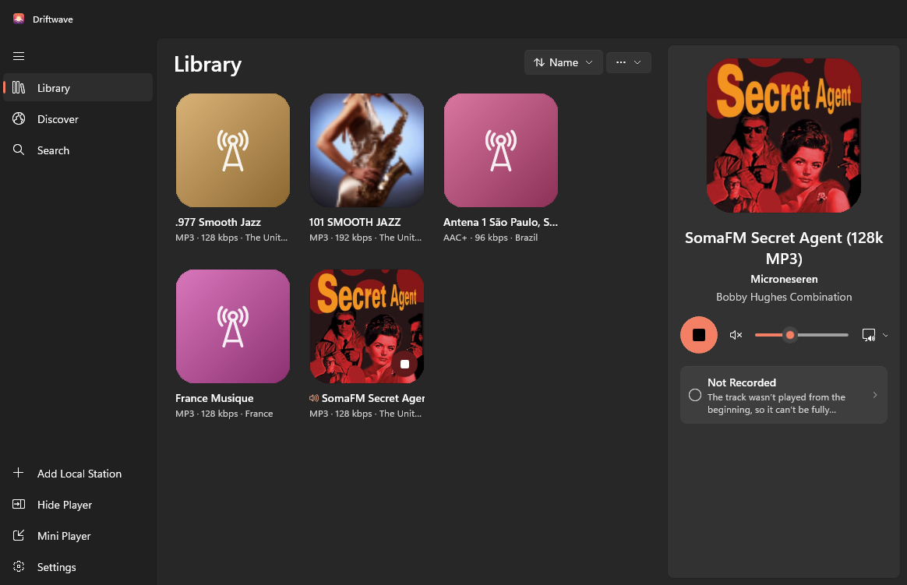

> **Driftwave 1.0 Beta 1** is out. It's the first release on the main channel. Please [report anything odd](https://github.com/Joshspeakman/driftwave/issues).

## Features

- **Discover and search** tens of thousands of stations from [radio-browser.info](https://www.radio-browser.info), by name, country, language or tag, or add your own stream.
- **Your library** of stations, with your own covers. Import and export it as a file.
- **Now playing:** song titles shown in time with what you hear, in the app, in the Windows media overlay and on your media keys.
- **Recording:** each song saved as its own file (MP3, or AAC in .m4a), copied exactly with no re-encoding, cut where the title changes. Save everything, or pick song by song.
- **Mini player**, a notification-area icon, background playback and notifications.
- **Themes:** the Windows look by default, plus 25 built-in themes and your own:
  - nine originals, from Retrowave to Analog 70s;
  - 17 homages to Windows 3.1 to 11, classic Mac OS to today's Mac, the iPhone, DOS, a rainy Tokyo night, Atari, Nokia, SNES, Genesis and Winamp, each with hidden easter eggs.
  - Realistic themes use real photographs and real-looking rain.
  - Effects are calm: no flashing, ever.
- **Your own background:** a GIF or picture from your PC or from GIPHY, looping behind the window in any theme. Every GIF is checked, and anything that flashes is refused.
- **One-click updates** in Settings, with the station carrying on across the restart.

| | |
|---|---|
| 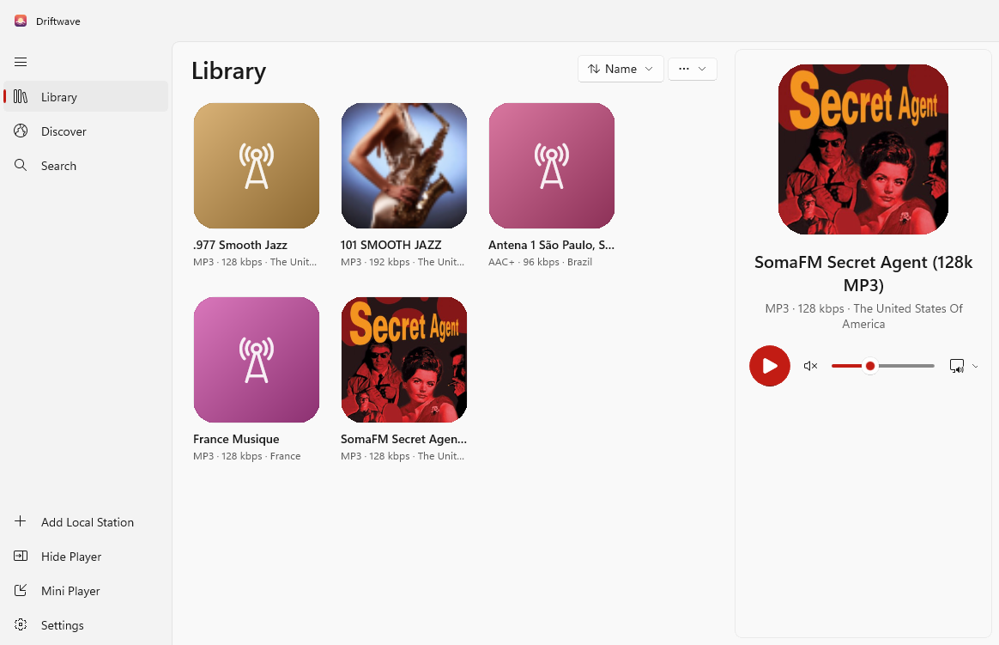 | 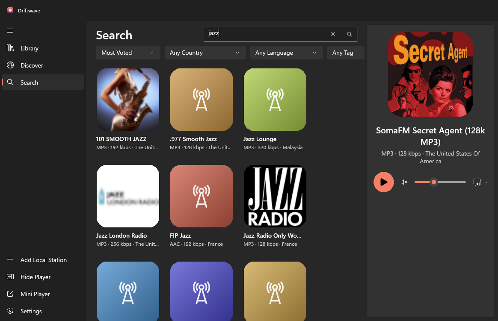 |
| 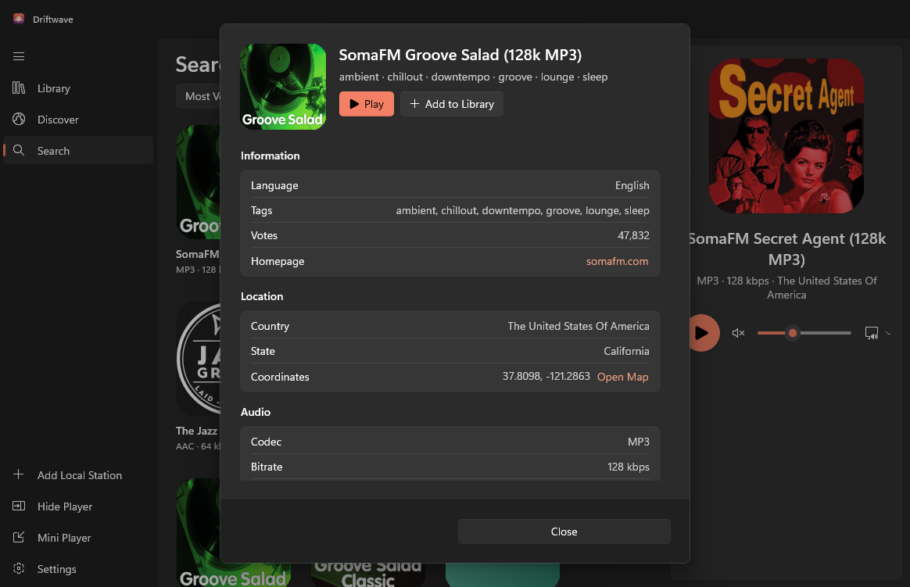 | 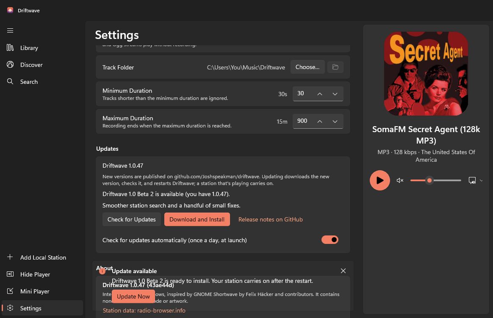 |

### Themes

| | | |
|---|---|---|
| 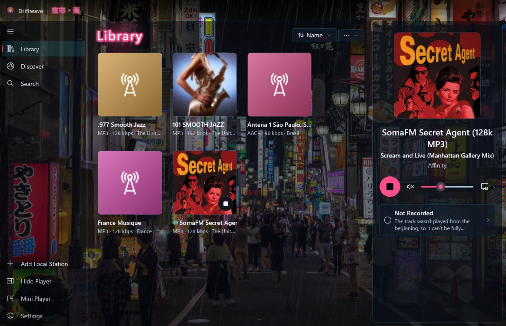 Night Market | 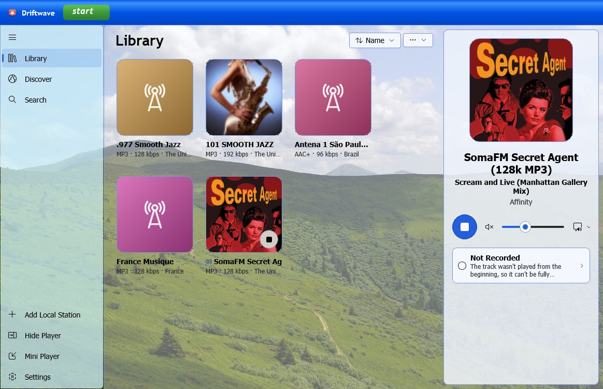 Luna | 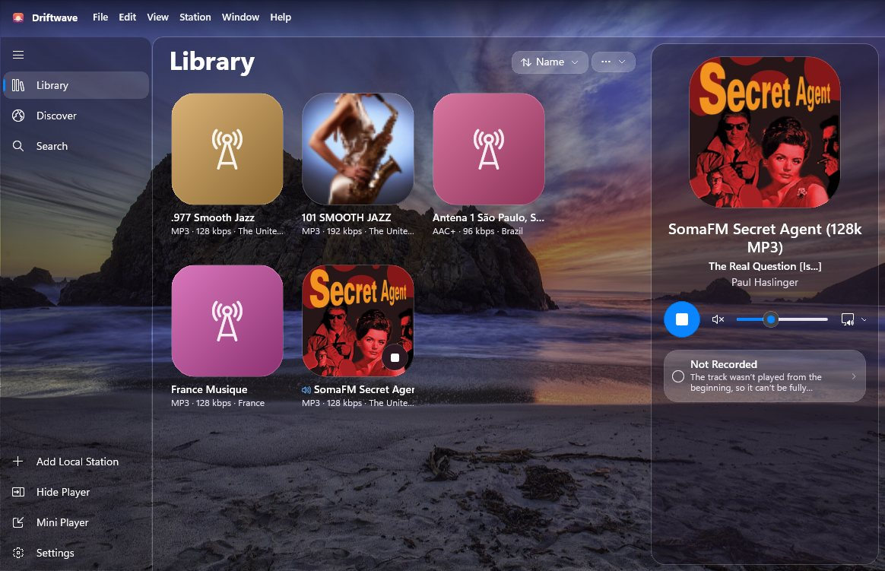 Big Glass |
| 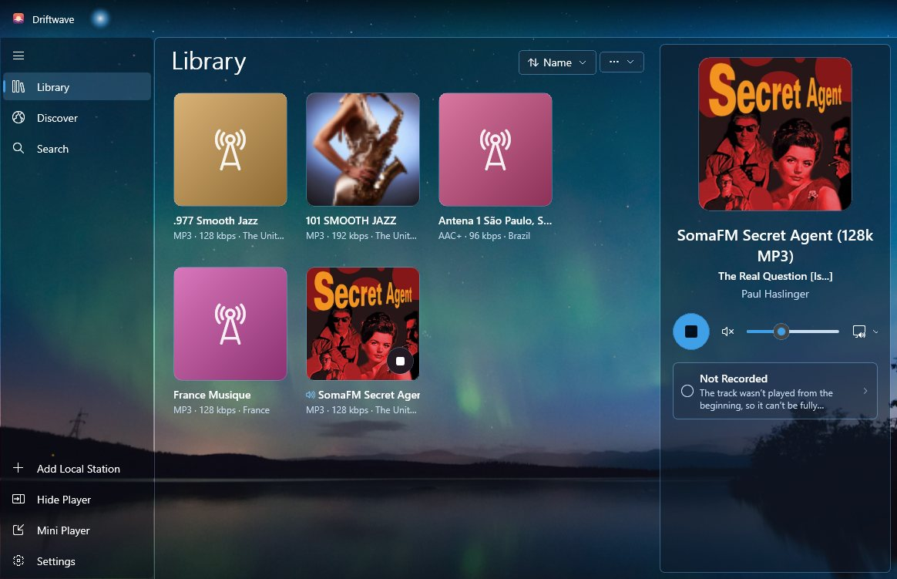 Aurora Glass | 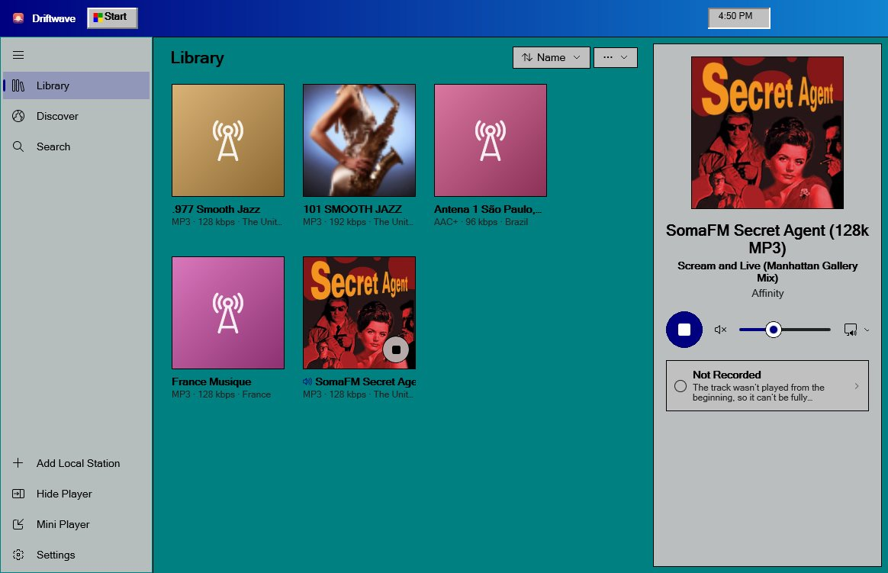 Ninety-Five | 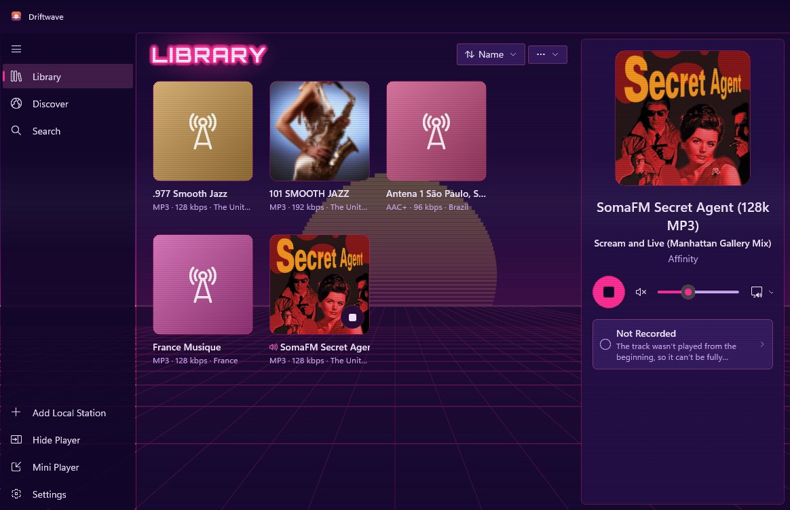 Retrowave |
| 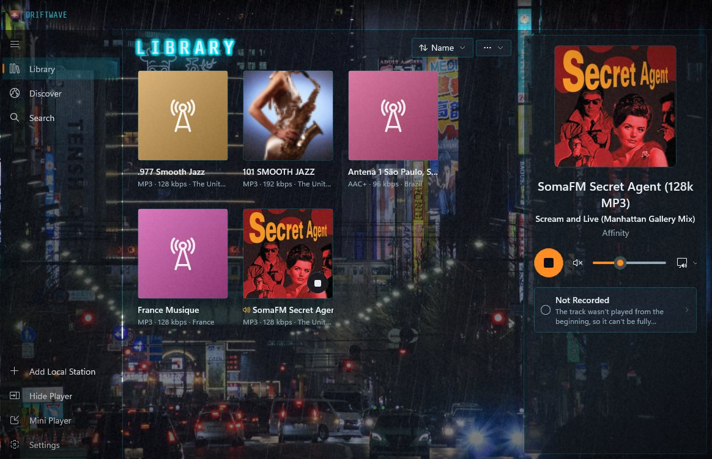 Neon Noir | 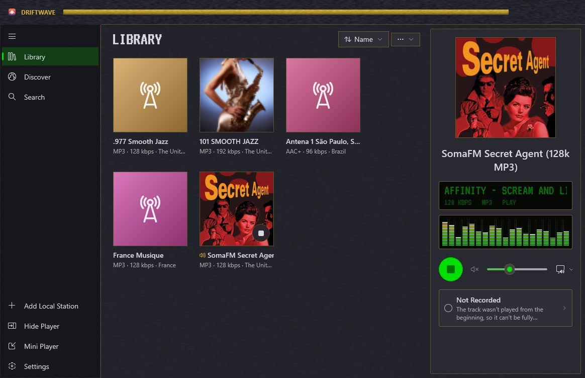 Llama Whip | 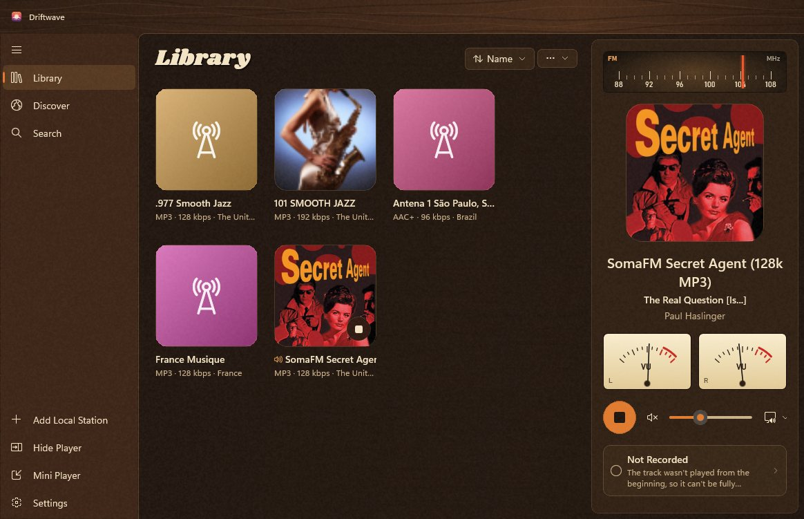 Analog 70s |

All 26 are pictured in the [Themes](https://github.com/Joshspeakman/driftwave/wiki/Themes) guide.

## Install

Driftwave runs on Windows 10 and 11 (x64) and needs the .NET 10 Desktop Runtime:

```
winget install Microsoft.DotNet.DesktopRuntime.10
```

1. Download `Driftwave-…-win-x64.zip` from [Releases](https://github.com/Joshspeakman/driftwave/releases).
2. Extract it, right-click **Install.ps1** and choose **Run with PowerShell**. No admin rights are needed.
3. Start **Driftwave** from the Start menu.

There are two channels:

| Channel | Zip | Updates |
|---|---|---|
| **Driftwave** | `Driftwave-<version>-win-x64.zip` | Betas now, then 1.0 |
| **Driftwave Nightly** | `Driftwave-Nightly-<version>-win-x64.zip` | Latest changes, often |

They install side by side.

The builds aren't code-signed yet, so Windows SmartScreen may ask first (*More info* > *Run anyway*). Every release has a `.sha256` file, and the app checks each update against it.

The [Install](https://github.com/Joshspeakman/driftwave/wiki/Install) page covers details, uninstalling and where your files live.

## User guide

The [wiki](https://github.com/Joshspeakman/driftwave/wiki) covers:

- [Getting Started](https://github.com/Joshspeakman/driftwave/wiki/Getting-Started)
- [Your Library](https://github.com/Joshspeakman/driftwave/wiki/Your-Library)
- [Listening](https://github.com/Joshspeakman/driftwave/wiki/Listening)
- [Recording](https://github.com/Joshspeakman/driftwave/wiki/Recording)
- [Themes](https://github.com/Joshspeakman/driftwave/wiki/Themes)
- [Keyboard Shortcuts](https://github.com/Joshspeakman/driftwave/wiki/Keyboard-Shortcuts)
- [Updates](https://github.com/Joshspeakman/driftwave/wiki/Updates)
- [Troubleshooting](https://github.com/Joshspeakman/driftwave/wiki/Troubleshooting)
- [Privacy](https://github.com/Joshspeakman/driftwave/wiki/Privacy)

## Privacy

There's no account, no analytics and no tracking. Driftwave talks only to:

- radio-browser.info, for the station directory;
- the stations you play;
- GitHub, for updates.

Your library and settings stay on your PC.

## Credits

Driftwave is inspired by **[Shortwave](https://gitlab.gnome.org/World/Shortwave)**, the GNOME internet radio app by Felix Häcker and contributors. Shortwave is a lovely, carefully made app, and it's what gave Driftwave its shape. Go and try it if you use Linux.

Driftwave is a separate app written from scratch. It contains none of Shortwave's code, artwork or other assets, and it isn't affiliated with or endorsed by the Shortwave or GNOME projects.

Station data comes from the community-run [radio-browser.info](https://www.radio-browser.info). Theme photographs are from Wikimedia Commons under free licences, and the theme fonts are under the SIL Open Font License. [THIRD-PARTY-NOTICES.md](THIRD-PARTY-NOTICES.md) credits everyone.

## Feedback

Found a bug or have an idea? [Open an issue](https://github.com/Joshspeakman/driftwave/issues).

## Insert Coin

If this saved you some time (or saved you from buying something twice), you can buy me a Continue on Ko-fi. It's $5 and it keeps me building stuff like this.

[](https://ko-fi.com/speakerjosh)
