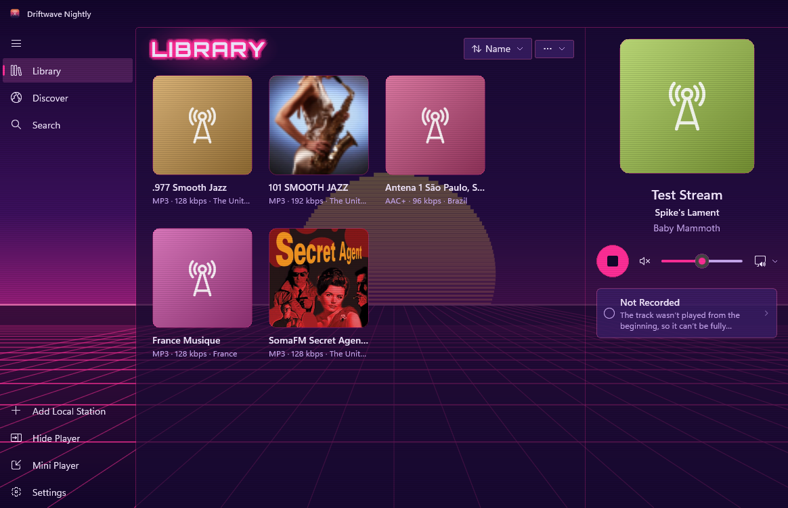
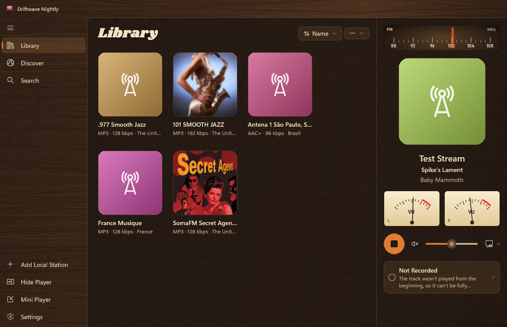
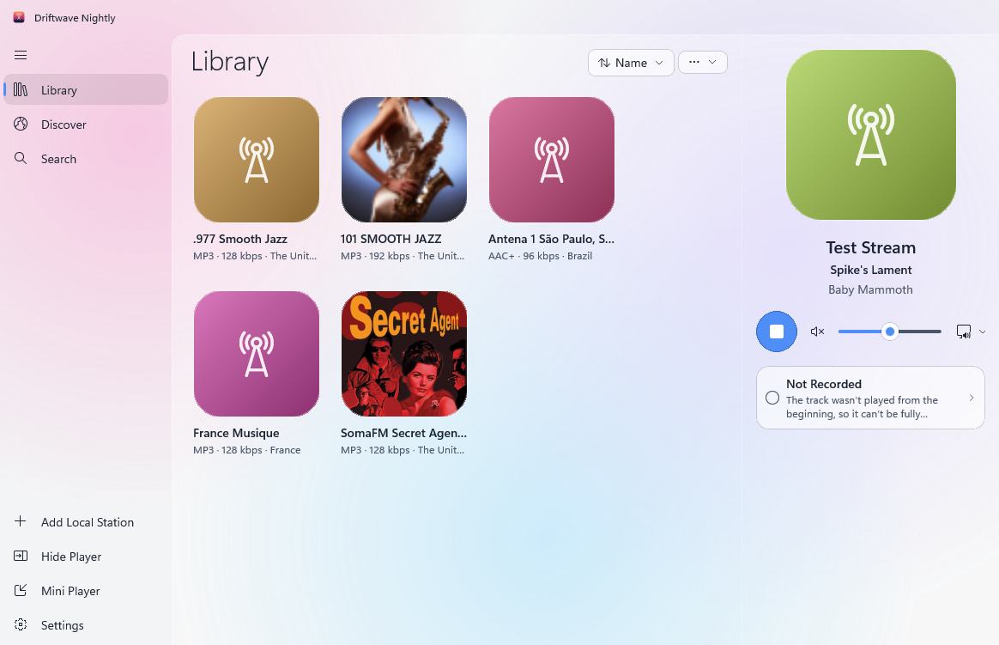
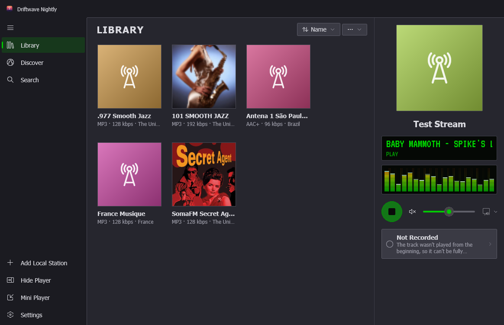
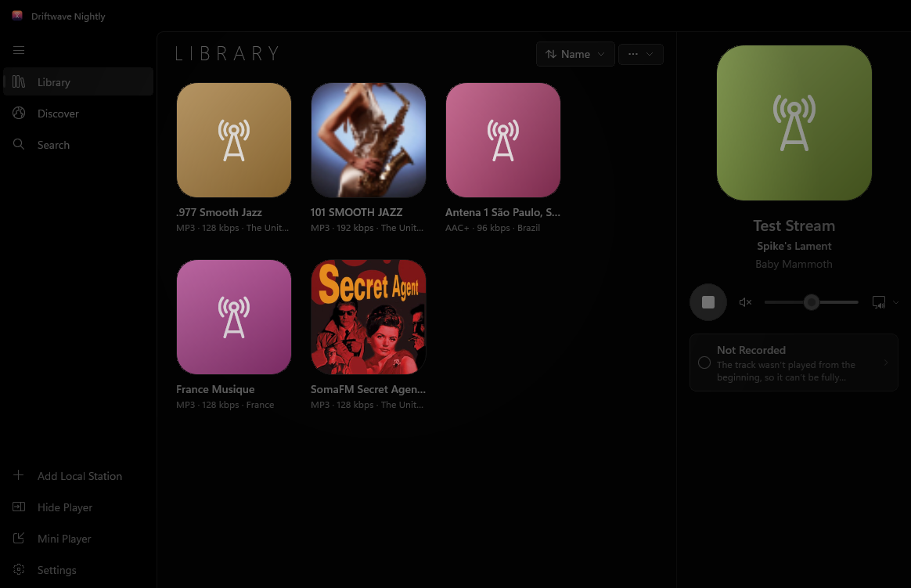
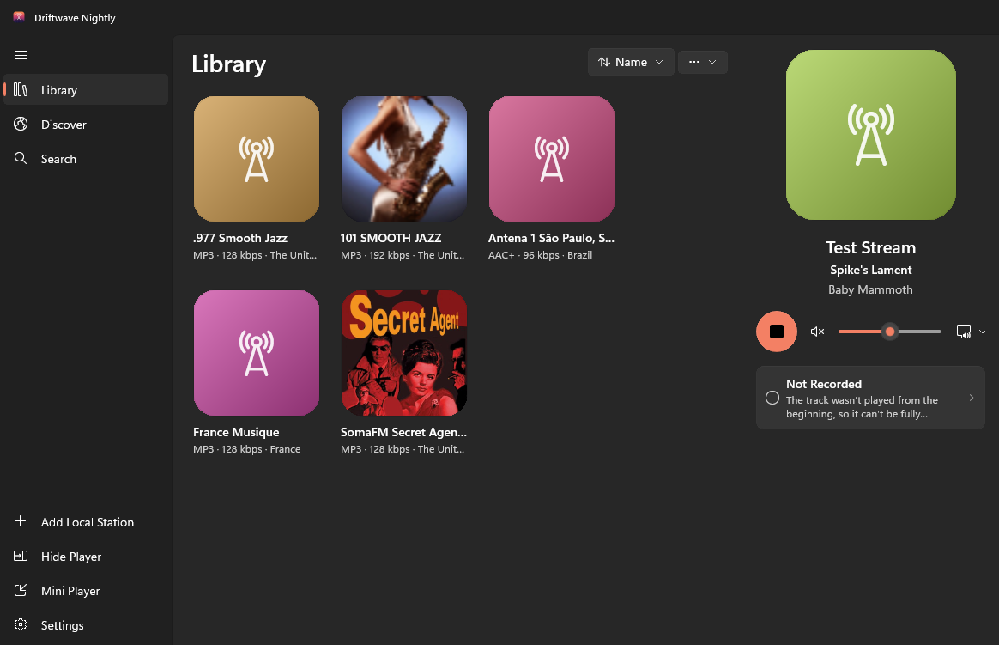
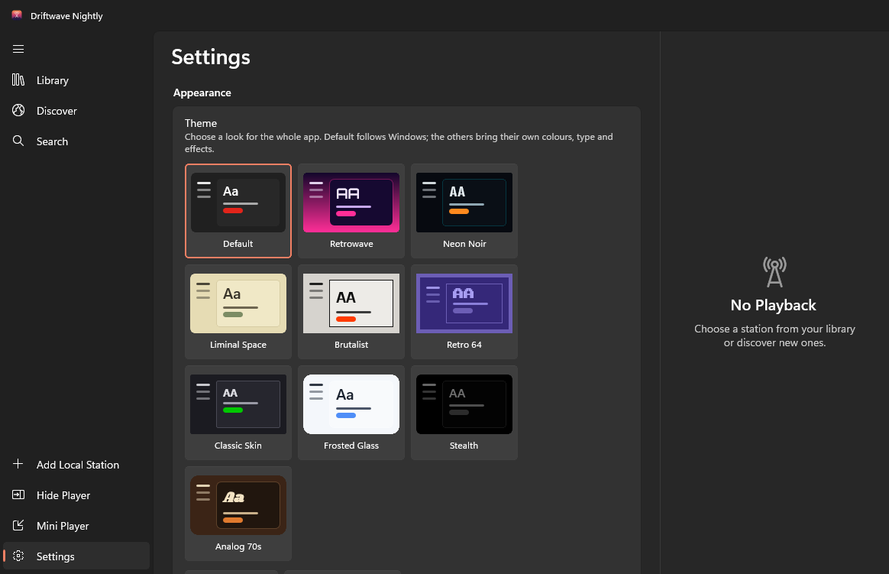

# Driftwave

Internet radio for Windows. Driftwave finds stations in the [radio-browser.info](https://www.radio-browser.info) directory, plays them, shows what's on, and can save each song as its own file as it plays.



## Features

- **Discover and search** tens of thousands of stations from radio-browser.info, or add your own stream.
- **Your library** of stations, with your own cover art. Import and export it as a file.
- **Now playing**: song titles from Icecast and Shoutcast streams, in the app, in Windows' media overlay and on media keys.
- **Recording**: each song is saved as a separate file, cut at the moment the title changes. Songs you join halfway through are left out.
- **Mini player** and a notification-area icon.
- **Themes**: the Windows look by default, plus nine built-in themes (Retrowave, Neon Noir, Liminal Space, Brutalist, Retro 64, Classic Skin, Frosted Glass, Stealth, Analog 70s) with small, calm effects: no flashing, ever. Make your own in Settings or as a JSON file.
- **Updates** from this page, in Settings > Updates. Your station keeps playing across the restart.

| | |
|---|---|
|  |  |
|  |  |
|  |  |

## Install

Driftwave runs on Windows 10 and 11 (x64) and needs the .NET 10 Desktop Runtime:

```
winget install Microsoft.DotNet.DesktopRuntime.10
```

1. Download the latest `Driftwave-…-win-x64.zip` from [Releases](https://github.com/Joshspeakman/driftwave/releases). Nightly builds are marked *Pre-release*.
2. Unzip it, right-click **Install.ps1** and choose **Run with PowerShell**. No admin rights are needed.
3. Start **Driftwave** from the Start menu.

It installs to `%LOCALAPPDATA%\Programs\Driftwave` (or `Driftwave Nightly`). To remove it, use Settings > Apps.

The builds aren't code-signed yet, so Windows SmartScreen may ask before running them. Each release has a `.sha256` file next to the zip. The app checks the download against it before it installs an update.

## Updates

Settings > Updates checks this repository's releases, shows what's new, and installs with one click. It checks automatically at launch, at most once a day, and you can turn that off. Driftwave only downloads release files from this repository, over HTTPS. If an update fails, it puts the previous version back.

## Your data

Your library, settings and themes live in `%APPDATA%\Driftwave`. Recordings go to `Music\Driftwave` unless you choose another folder. Driftwave sends nothing anywhere except:

- station searches to radio-browser.info;
- the streams you play;
- the update check to GitHub.

## Credits

Driftwave is inspired by **[Shortwave](https://gitlab.gnome.org/World/Shortwave)**, the GNOME internet radio app by Felix Häcker and contributors. Shortwave is a lovely, carefully made app, and it's what gave Driftwave its shape. Go and try it if you use Linux.

Driftwave is a separate app written from scratch. It contains none of Shortwave's code, artwork or other assets, and it isn't affiliated with or endorsed by the Shortwave or GNOME projects.

Station data comes from the community-run [radio-browser.info](https://www.radio-browser.info). The theme fonts are under the SIL Open Font License; see [THIRD-PARTY-NOTICES.md](THIRD-PARTY-NOTICES.md).

## Feedback

Found a bug or have an idea? [Open an issue](https://github.com/Joshspeakman/driftwave/issues).
