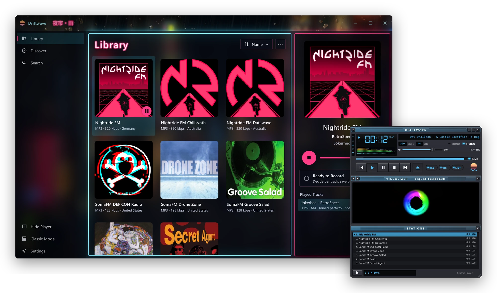
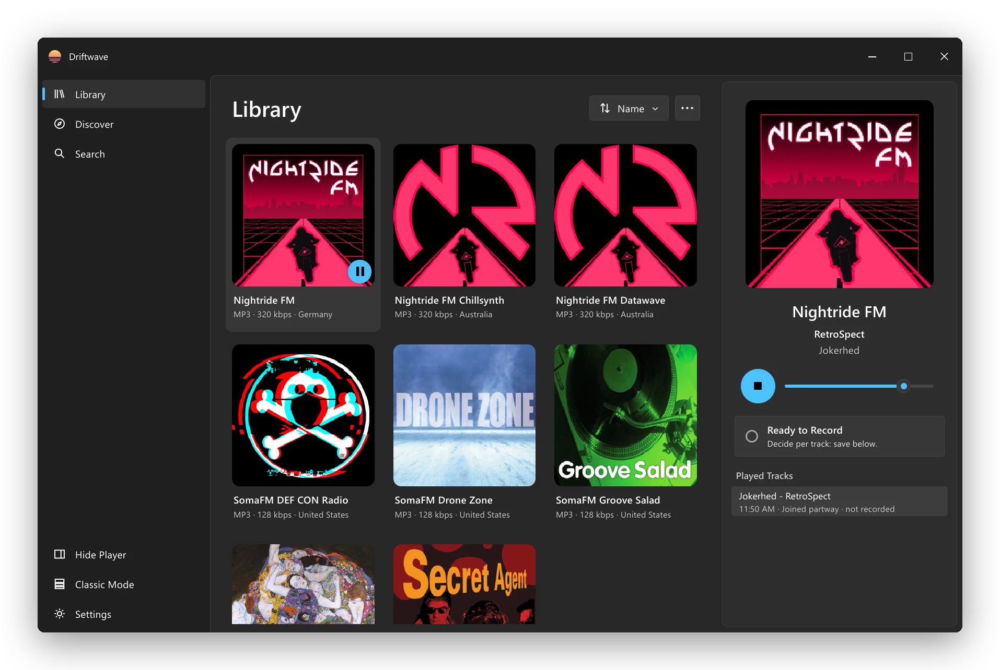
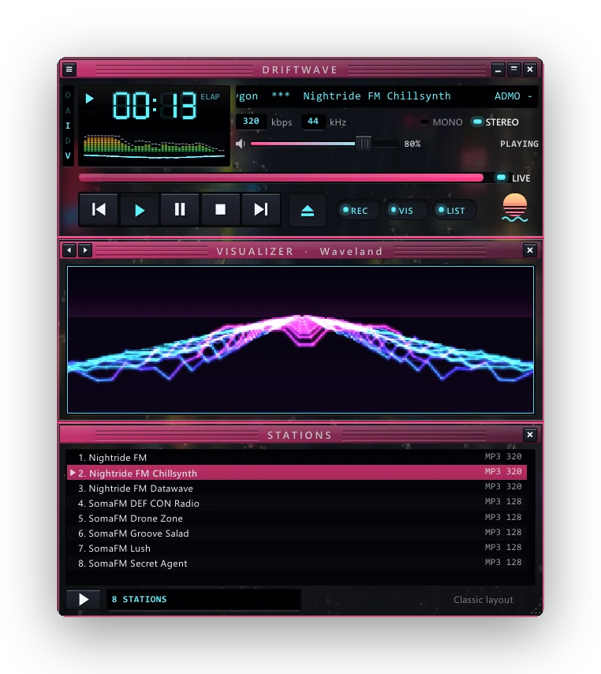
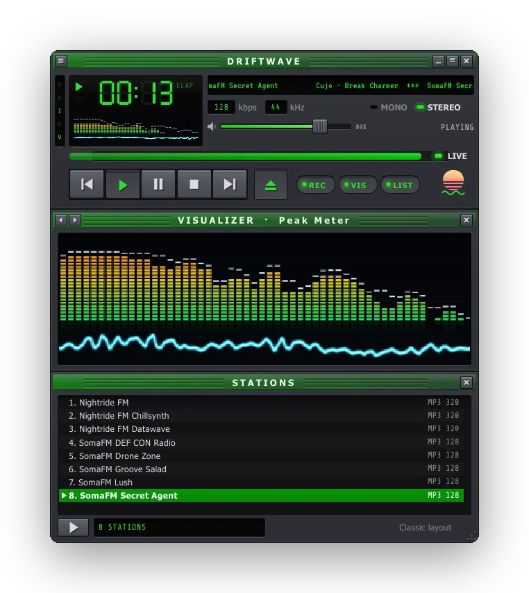
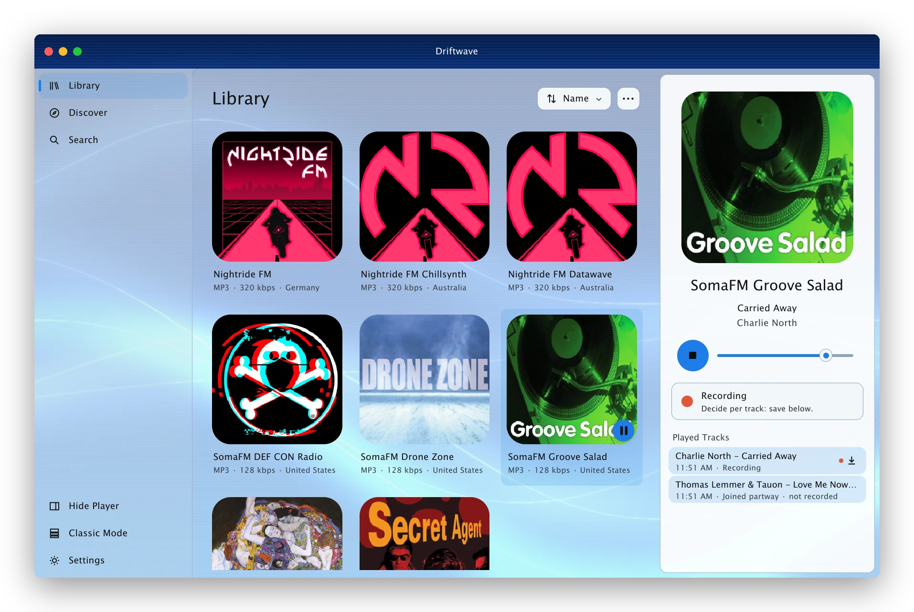
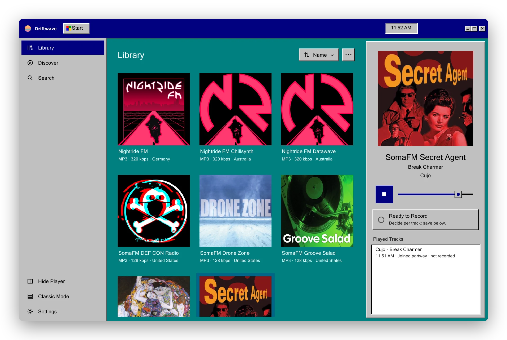

  <picture>
    <source media="(prefers-color-scheme: dark)" srcset="brand/logo-wordmark-dark.png">
    
  </picture>

<b>Internet radio for Windows and macOS (Linux to follow).</b> Find a station, hear what's on, and keep the songs you love.

  

## Download

**[Driftwave 1.0.0-alpha.1](https://github.com/Joshspeakman/driftwave/releases/tag/v1.0.0-alpha.1)** for Windows (64-bit): download
the zip, unzip it, right-click `Install.ps1` and choose *Run with PowerShell*. It installs for you alone, no admin
rights needed, and updates itself from Settings > Updates. It's an alpha: expect rough edges, and please
[tell us about them](https://github.com/Joshspeakman/driftwave/issues). The Mac build will follow.

## One app, two looks

Driftwave is one small app, written in Rust, with one window and two looks. You swap between them while the music
carries on.

**Full:** your library, Discover and Search, station details, the player with the songs it has played, recording,
and Settings.

**Classic:** an LCD, a scrolling title, six original visualizers and a station list, stacked like the players of the
late 90s. Right-click anywhere for its menu.

| | | |
|---|---|---|
|  |  |  |

**Themes:** Default plus 26 built-ins, every one in both layouts: photo scenes with rain on the glass and neon,
homages to the desktops of their eras, your own themes from the theme editor, and your own picture or GIF behind the
window. Nothing ever flashes.

| | |
|---|---|
|  |  |
|  |  |

## Open source

Driftwave is free software under the [GNU General Public License](LICENSE), version 3 or (at your option) any later
version. The source is at **[Joshspeakman/shortwave-macos](https://github.com/Joshspeakman/shortwave-macos)**.

## Credits

Driftwave is based on **[Shortwave](https://gitlab.gnome.org/World/Shortwave)**, the GNOME internet radio app by
Felix Häcker and contributors (GPL-3.0-or-later): its design for finding, playing and recording internet radio, and
parts of its recording model and wording. Driftwave isn't affiliated with or endorsed by the Shortwave or GNOME
projects.

Station data comes from the community-run [radio-browser.info](https://www.radio-browser.info).
[THIRD-PARTY-NOTICES.md](THIRD-PARTY-NOTICES.md) credits the fonts and photographs Driftwave uses.

## Feedback

Found a bug or have an idea? [Open an issue](https://github.com/Joshspeakman/driftwave/issues).

## Insert Coin

If this saved you some time, you can buy me a Continue on Ko-fi. It's $5 and it keeps me building stuff like this.

